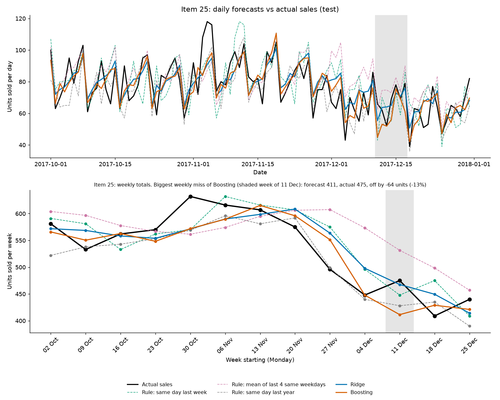

# Store Demand Forecast

**Track:** Finance

**Team:** Max Scheufele, Voehlin Gymnasium Memmingen

## The problem

A small shop owner orders stock every Monday for the week; too little loses sales, too much wastes money.

## What I built

**In:** past daily sales of 8 items from one store (item numbers are the dataset's item IDs). **Out:** one weekly order per item. I compared three simple rules with Ridge regression (a weighted sum of inputs) and gradient boosting (many small decision trees), my main model.

## What I added

1. **An order-decision simulation:** each order gets a cost, 3 per unit short and 1 per unit left over. 3 to 1 is my assumption.
2. **A failure analysis:** where and why the main model misses.

## How it works

- **Setup.** Train to 2017-06-30, validation 2017-07-01 to 2017-09-30, test 2017-10-01 to 2017-12-31. Features use only sales from 7+ days back. Order = 7 daily forecasts plus a safety buffer.
- **Test period.** I fixed every choice before using the test period, except that an early figure showed Oct to Dec 2017 sales once, before modelling. Nothing was tuned on it.

To run it: Kaggle's `train.csv` is already in the repo root (see `data/README.md`); run `pip install -r requirements.txt` (Python 3.12; `lightgbm` is installed, not used), then run the notebook from the repo root or double-click `run.bat`. A run rewrites `results/` and adds an entry to the run log.

## Results

Test period, lower is better. MAE is the average miss in units, SMAPE the miss in percent of sales, weekly MAE the miss on weekly totals. Order cost: 13 weeks.

| Method | Daily MAE | SMAPE % | Weekly MAE | Order cost (3:1, tuned buffer) |
|---|---|---|---|---|
| Same day last week (lag 7) | 8.68 | 19.81 | 24.76 | 4,050 |
| Mean of last 4 same weekdays | 8.14 | 18.17 | 34.33 | 4,929 |
| Same day last year (lag 364) | 8.14 | 19.12 | 26.45 | 4,188 |
| Ridge | 6.38 | 16.16 | 21.85 | 3,972 |
| Gradient boosting | 6.18 | 14.36 | 18.09 | 3,100 |

Boosting had the lowest error and the lowest order cost. Its cost is 26.0% lower than lag 364, the baseline I fixed in advance (25.3% at 1:1, 25.9% at 5:1). Lag 7 was the cheapest simple rule but not fixed in advance; boosting is 23.5% below it.

**Where it did badly.**
- With no safety buffer, lag 7 beat boosting at 3:1 by a small margin (4,341 against 4,403) and was cheapest at 5:1 (6,107 against 6,921).
- On item 25 at 3:1 with tuned buffers, lag 364 beat boosting (540 against 546).
- Ridge's cost gain over the simple rules was unclear. Boosting forecasts lean low (-0.83 units a day).
- I tuned the buffers on the validation weeks I used to pick the model, and I changed the rule for the main model after seeing validation results: from lowest daily MAE (Ridge was slightly ahead) to lowest order cost.
- Small sample: 13 weeks, 8 items, one store.

**Failure example.** Boosting's biggest weekly miss: item 25, week of 2017-12-11, forecast 411.4, actual 475.0, 13.4% too low.

*Hypothesis, not tested:* boosting followed an earlier fall.

## What to do next (Hypothetically)

- Test on real shop data with real costs.

## Sources

- **Dataset:** Kaggle Store Item Demand Forecasting Challenge, https://www.kaggle.com/c/demand-forecasting-kernels-only. `train.csv` is included for convenience; Kaggle's terms apply.
- **Libraries (see `requirements.txt`):** pandas, numpy, scikit-learn, matplotlib, scipy, Jupyter.
- **AI tools:** I used AI tools (Claude Code) a lot in this project. It wrote much of the code with me, wrote the GUI launcher and helped write this README/The final hand in notebook. I picked the ideas and checked the results.
- **Tutorials:** No code was copied from tutorials or other notebooks. I looked at other people's code(Kaggle submissions) for ideas.